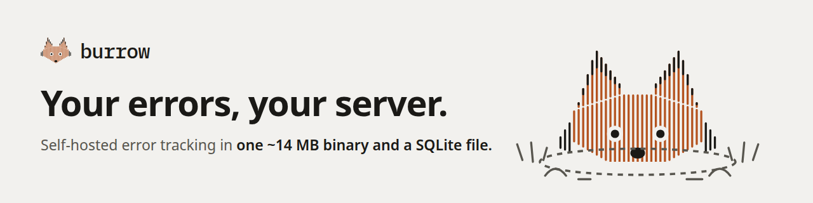

<picture>
  <source media="(prefers-color-scheme: dark)" srcset="brand/social/banner-dark.png">
  
</picture>

# 🦊 Burrow

**Lightweight, self-hosted, open-source error tracking that works with the Sentry SDKs you already use.**

Burrow is a single ~14 MB binary with an embedded dashboard and SQLite storage.
There's no Redis, no Kafka and no ClickHouse. It idles at about 15 MB of memory and
handles over 1,500 events a second on one CPU core. Point your existing
Sentry SDK's DSN at it and your errors show up, grouped into issues, with stack
traces, breadcrumbs, tags and user context.

> Burrow is an independent project and is not affiliated with or endorsed by
> Functional Software, Inc. "Sentry" is their trademark. Burrow implements the
> publicly documented Sentry ingestion protocol so the MIT-licensed Sentry SDKs
> can talk to it.

## Features

- **Drop-in SDK compatibility.** It accepts `/api/<id>/envelope/` and legacy `/api/<id>/store/`,
  gzip/deflate bodies, all SDK auth styles, and CORS for browser SDKs. It's tested against
  the official `sentry-sdk` (Python) and `@sentry/node`.
- **Smart grouping.** Events group by exception type plus in-app call path. Line numbers,
  JS bundle hashes, and the volatile parts of messages (numbers, UUIDs, IPs, hex,
  timestamps, quoted values) are ignored, so `timed out after 3000ms` and `timed out after
  4521ms` land in the same issue. SDK-side `fingerprint` (including `{{ default }}`) is honored.
- **Teams.** Projects belong to teams; only a team's members see its projects and issues.
  Members triage, owners also manage members, invites, keys, webhooks and projects, and
  instance admins manage every team and account. People join through single-use, expiring
  invite links, optionally locked to an email address.
- **Issue workflow.** Resolve, ignore, or delete issues. A resolved issue that happens again
  **reopens automatically** (regression).
- **Event detail.** Chained exceptions, stack frames with source context and locals,
  breadcrumbs, request, user, tags, contexts, raw JSON, and a 14-day activity chart.
- **Report API.** No SDK for your platform? POST plain JSON to `/api/<id>/report`. Stack
  traces in Luau, Lua, Python or JavaScript text become frames, so Roblox game servers,
  shell scripts and cron jobs can report too. See [Report API](#report-api).
- **Alerts.** Each project has its own webhooks and email recipients, set in its settings: new
  issues, regressions, or both, each with a **Send test** button. Webhooks work with Slack,
  Discord, Mattermost, or any custom endpoint. Emails match the dashboard's look, include the
  issue's 14-day activity, and are capped at 20 an hour per address.
- **Email (optional).** With SMTP set up, Burrow emails alerts and team invites. Admins can
  check the setup with **Send test email** on their account page.
- **Idempotent ingestion.** SDK retries never double-count.
- **Retention.** Old events are pruned automatically (30 days by default).
- **Secure defaults.** bcrypt passwords, login throttling, hashed session tokens, CSRF tokens,
  a strict CSP, HSTS, SameSite cookies, a per-project ingestion rate limit, webhooks that refuse
  private addresses and can't be used to @-mention a channel, and a non-root distroless container.

## Quick start

### Docker

```sh
docker compose up -d
open http://localhost:8000
```

### From source (Go 1.26+)

```sh
go build -o burrow ./cmd/burrow
./burrow
```

On first visit you'll create the admin account and your first team. Then create a project,
copy its DSN, and:

```python
import sentry_sdk
sentry_sdk.init(dsn="http://<key>@localhost:8000/1")
1 / 0
```

Not ready to wire up an SDK? Every project has a **Send test event** button.

Invite teammates from **Teams**: each invite is a single-use link you send however you like.

## Report API

For runtimes without a Sentry SDK. Send one report, a JSON array of up to 100, or
`{"reports": [...]}`. The key is the project's public key (the one in its DSN), sent as
`X-Burrow-Key`, `Authorization: Bearer <key>`, or `?key=`.

```sh
curl https://errors.example.com/api/1/report \
  -H "X-Burrow-Key: <key>" -H "Content-Type: application/json" \
  -d '{"message": "Payment failed", "level": "error", "stack": "...",
       "environment": "production", "tags": {"region": "eu"}}'
```

Fields: `message` (required), `type`, `stack`, `level`, `platform`, `environment`,
`release`, `server_name`, `logger`, `transaction`, `tags`, `user`, `extra`, `fingerprint`,
`event_id`, `timestamp`. The response is `{"ids": [...]}`.

**Roblox.** Create a project with the *Roblox (Luau)* platform and its settings page gives
you a ready-made ModuleScript, filled in with your URL and key. It catches every server
error through `ScriptContext.Error`, relays client errors through a RemoteEvent, and
batches reports to stay well inside Roblox's HTTP limits. Roblox servers only reach public
HTTPS addresses, so Burrow has to be deployed with a public `BURROW_BASE_URL`.

## Configuration

Every option can be set with a flag or an environment variable.

| Env var | Flag | Default | Description |
|---|---|---|---|
| `BURROW_ADDR` | `-addr` | `:8000` | Listen address |
| `BURROW_DB` | `-db` | `burrow.db` | SQLite database file |
| `BURROW_BASE_URL` | `-base-url` | `http://localhost<addr>` | Public URL. It goes into DSNs and alert links, and `https://` enables secure cookies. **Set this in production.** |
| `BURROW_RETENTION_DAYS` | `-retention-days` | `30` | Delete events older than this. `0` keeps them forever. |
| `BURROW_WEBHOOK_URL` | `-webhook-url` | | Fallback webhook for projects that have none of their own in settings |
| `BURROW_WEBHOOK_ALLOW_PRIVATE` | `-webhook-allow-private` | `false` | Allow webhooks on private/LAN addresses. Refused by default so a webhook can't be pointed at internal services. |
| `BURROW_RATE_LIMIT` | `-rate-limit` | `3000` | Events per minute each project may send. Over it, Burrow answers `429` with `Retry-After`, which the Sentry SDKs back off on. `0` turns it off. |
| `BURROW_SMTP_HOST` | `-smtp-host` | | SMTP server for email alerts and invites. Email is off when empty. |
| `BURROW_SMTP_PORT` | `-smtp-port` | `587` | SMTP port |
| `BURROW_SMTP_TLS` | `-smtp-tls` | by port | `starttls` (587), `tls` (465), or `none` for a relay on the same machine. STARTTLS is required unless you choose `none`. |
| `BURROW_SMTP_USERNAME` | `-smtp-username` | | SMTP login, if your server needs one |
| `BURROW_SMTP_PASSWORD` | (env only) | | SMTP password. Environment only, so it never shows in process listings. |
| `BURROW_SMTP_FROM` | `-smtp-from` | | Sender, e.g. `Burrow <alerts@example.com>`. Required with a host. |
| `BURROW_BEHIND_PROXY` | `-behind-proxy` | `false` | Set when a reverse proxy sits in front, so login throttling uses the client address the proxy adds to `X-Forwarded-For` rather than the proxy's own. |

## System requirements

| | Minimum | Recommended |
|---|---|---|
| CPU | 1 core | 1 core is plenty below ~1,000 events/s |
| Memory | 64 MB | 256 MB, so the OS can cache the database |
| Disk | SSD, ~5 KB per stored event | SSD with room for your retention window |
| OS | Linux (measured on amd64) | Pure Go, so it also builds for arm64, macOS and Windows |

What it uses, measured with realistic Python SDK events (4.5 KB each, with stack
frames, source context, locals and breadcrumbs):

| | |
|---|---|
| Memory | ~15 MB idle, 25–30 MB at full ingest speed, ~45 MB with 300k events stored |
| CPU | 0.4–0.9 ms per event, so 50 events/s is about 3% of one core |
| Throughput | ~1,750 events/s on 1 core, ~2,150 on 2 or more (one SQLite writer) |
| Disk | ~5.1 KiB per event |
| Startup | under 0.1 s |

**Sizing the disk:** events per day × retention days × 5 KB. For example, 10,000 events a
day kept for 30 days is about 1.5 GB. Retention frees space for new events, but the file
doesn't shrink; run `sqlite3 burrow.db VACUUM` while Burrow is stopped to reclaim it.

Keep the database on a local disk, not NFS/SMB (SQLite locking) or a RAM-backed `/tmp`
(it would count against memory). Full numbers and how to reproduce them are in
[docs/benchmarks.md](docs/benchmarks.md).

### Running in production

- Put Burrow behind a TLS-terminating reverse proxy (Caddy, nginx, Traefik) and set
  `BURROW_BASE_URL=https://errors.example.com`.
- Set `BURROW_BEHIND_PROXY=true` when the proxy is the only way in, so failed logins are
  counted per visitor rather than per proxy.
- Back up the SQLite file. `sqlite3 burrow.db ".backup backup.db"` is safe while it's running.
- Point SDKs at the same public URL. Browser SDKs need it reachable from your users' browsers.

## Architecture

```
cmd/burrow          entrypoint, config, background maintenance
internal/ingest     Sentry-protocol endpoints: envelope parsing, auth, decompression
internal/event      event normalization (many SDK shape variants -> one) + grouping
internal/store      SQLite (pure Go, no cgo), migrations, queries
internal/web        dashboard: server-rendered html/template, embedded static assets
internal/notify     webhook alerts
```

Design choices, in short: **boring tech, one process, one file of state.** Server-rendered
HTML means no JS build chain for contributors, and pages work even with JavaScript disabled.
SQLite in WAL mode comfortably handles the error volumes of small and medium teams. See
[ROADMAP.md](ROADMAP.md) for where it's going, including Postgres support for larger installs.

## Development

```sh
go test ./...          # unit + end-to-end tests (spins up a real server)
go run ./cmd/burrow    # http://localhost:8000
```

See [CONTRIBUTING.md](CONTRIBUTING.md).

## License

[MIT](LICENSE)
